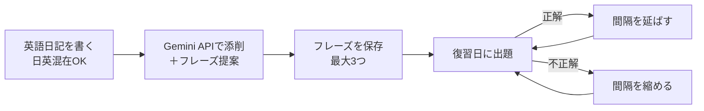
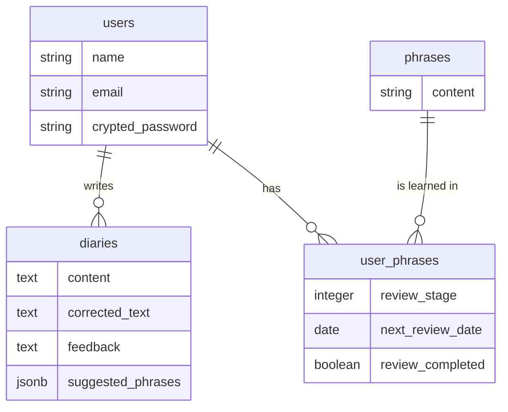

# 英語ダイアリー

**英語日記 → AI添削 → フレーズ保存 → 忘却曲線に沿った復習**を1つのアプリで回せる、英語ライティング学習アプリです。
日英が混ざった日記をそのままAIに添削してもらい、学んだ表現を「忘れかけた頃」に自動で復習できます。

## デモ

🔗 **アプリURL**：https://final-project-d423.onrender.com

> ※ 無料プランで公開しているため、初回アクセス時は表示まで30秒〜1分ほどかかる場合があります。

### テスト用アカウント

| 項目 | 内容 |
| --- | --- |
| メールアドレス | test@example.com |
| パスワード | test12345678 |

---

## 開発の背景

私は英語の表現の幅を広げるために、英語日記をGeminiに添削してもらい、学んだフレーズをノートに書き写して復習していました。この方法には、次の2つの不便がありました。

- 添削・記録・復習のたびに、Gemini・ノート・カレンダーを行き来する手間がかかる
- 復習のタイミングを自分で管理しなければならず、続かない

前職でも、紙のノートからOneNoteに切り替えて情報の検索性を上げたことで、業務効率が大きく改善した経験がありました。それと同じように、**学習の流れを1か所にまとめ、復習の管理をアプリに任せれば、忙しくても続けられる**と考えて開発しました。

**想定ユーザー**：自分の意見は英語で伝えられるものの、表現がマンネリ化している中級学習者（平日の夜1時間ほどで学習する社会人）

## 主な機能

| 機能 | 内容 |
| --- | --- |
| AI日記添削 | 日本語と英語が混ざった日記を、Gemini APIが自然な英語に添削し、日本語でフィードバックを返します |
| フレーズ提案・保存 | AIが提案する「覚えたいフレーズ」3つから選んで保存できます（1回3つまで） |
| 忘却曲線ベースの復習 | 保存したフレーズを最適な間隔で出題します。正解・不正解に応じて、次回の復習日が自動で変わります |
| 復習フレーズで作文 | その日の復習フレーズを使って短い文章を書き、使い方が自然かどうかをAIが添削します |
| 復習カレンダー | 月ごとの復習予定と、日記を書いた日をカレンダーで確認できます |
| 一覧 | 保存したフレーズと過去の日記を一覧で見返せます |
| アカウント | ユーザー登録・ログイン・メールアドレスとパスワードの変更 |

### 学習の流れ

## 技術スタック

| 分類 | 技術 |
| --- | --- |
| バックエンド | Ruby 3.3 / Ruby on Rails 7.1 |
| フロントエンド | Hotwire（Turbo / Stimulus）/ Tailwind CSS |
| データベース | PostgreSQL（Supabase） |
| 認証 | Sorcery |
| 外部API | Gemini API（ruby-openai経由でOpenAI互換エンドポイントを利用） |
| テスト・品質 | RSpec / FactoryBot / SimpleCov / Bullet / RuboCop |
| CI/CD | GitHub Actions |
| インフラ | Render |

## 工夫した点

### 1. 忘却曲線に基づく復習スケジュール（SRS）

フレーズごとに「復習段階」と「次回復習日」を持たせ、段階に応じて復習の間隔を延ばしています。

| 段階 | 0 | 1 | 2 | 3 | 4 |
| --- | --- | --- | --- | --- | --- |
| 次回までの間隔 | 1日 | 3日 | 7日 | 14日 | 30日 |

- **正解**：段階を1つ上げて、間隔を延ばします（上限は段階4）
- **不正解**：段階を1つ下げて、間隔を縮めます（下限は段階0）

不正解でも最初の段階に戻さず、1段階だけ下げる設計にしました。一度間違えただけでやり直しになると、学習のモチベーションが下がりやすいためです。間隔の定義は定数（`UserPhrase::REVIEW_STAGES`）にまとめてあるので、段階を増やしたいときは1行追加するだけで済みます。

### 2. Service Objectによる責務の分離

日付計算やAPI連携のロジックはService Objectに切り出し、コントローラを薄く保っています。これにより、ロジックを単体でテストできます。

| クラス | 役割 |
| --- | --- |
| `ReviewScheduleInitializer` | フレーズ保存時に、最初の復習日を設定する |
| `ReviewResultService` | 復習結果（正解・不正解）から、次の段階と次回の復習日を計算する |
| `PhraseSaveService` | フレーズの正規化（重複除去・3件上限）と保存を行う |
| `GeminiCorrectionService` | Gemini APIに添削を依頼し、結果を保存する |
| `ReviewCalendarBuilder` | カレンダー表示用に、復習予定を日付ごとにまとめる |

### 3. AIの出力を構造化データとして扱う

Gemini APIには **JSON形式（添削後の英文・フィードバック・提案フレーズ3つ）で返すよう指定**し、アプリ側でそのまま保存・表示できるようにしました。また、通常の日記添削と「復習フレーズを使った作文」の添削で、プロンプトを切り替えています。API呼び出しに失敗した場合でも、日記本文は保存されたうえでエラーメッセージを表示します。

### 4. データ設計

フレーズ本体（`phrases`）と、ユーザーごとの学習状況（`user_phrases`）を分けて管理しています。同じフレーズを複数のユーザーが保存しても、本体のデータは重複しません。また、`user_id` と `phrase_id` の組み合わせにユニーク制約を設けて、同じユーザーが同じフレーズを二重に登録できないようにしています。

### 5. テストとCI

- RSpecで、モデル・リクエスト・Service Objectのテストを書いています
- プルリクエストを作るたびに、GitHub Actionsで **RuboCop → アセットのビルド → RSpec** が自動で実行されます
- Bulletを使って、N+1クエリを開発中に検知しています

## 今後の改善予定

- **復習完了フラグの見直し**：完了の判定は次回の復習日だけで行えるため、`review_completed` フラグは冗長になっています。最後に復習した日（`last_reviewed_on`）を持つ設計に変えて、「今日の進捗」を表示できるようにする予定です
- **保存フレーズの検索機能**
- **フロントエンドのReact（Next.js）化**
- **学習を習慣化するためのリマインド通知**

## 開発について

- **開発期間**：2026年7月〜10月（RUNTEQ卒業制作）
- **AIツールの活用**：Cursorを活用しつつ、生成されたコードは読んで理解し、説明できる状態にすることを意識して開発しました
- **画面遷移図**：[Figma](https://www.figma.com/design/4TZx4K0V8tFzPrwdDqJfku/RUNTEQ_Final-project?node-id=0-1&p=f&t=nPtlhmujsjpgtzMD-0)

---

<b>企画時の設計資料（課題整理・ユーザー像・競合調査・技術選定）</b>

## 1. 課題の整理

### 表に見えている困りごと

* 学んだフレーズを毎回別のノートやツールに書き写すのがめんどくさい

### 本当に解決したい課題は何か

* 分からない、あるいは新しいフレーズに出会った際に、調べる・記録する行動に余計な時間がかかっている。
* なぜ時間がかかるのか？ ➔ Geminiや単語検索ページ、記録用ノートなどを行き来しなければいけないから。
* なぜ行き来するのか？ ➔ 日記執筆、添削、フレーズのインプット、復習のサイクルが1つの環境で完結していないから。
* **本当に解決したい課題：** 忙しい日常の中でも勉強時間を徹底的に効率化し、無駄な摩擦（手間）をなくすことで、挫折せずに英語学習を継続したい。

## 2. 想定ユーザーについて

### 想定しているユーザー

#### 年齢・スキル設定

* **年齢・ターゲット像：** 20代〜30代の社会人。TOEIC 800点程度。自分の意見を伝えることはできるが、いつも同じ表現ばかり使ってしまう中級レベルの英語学習者。学生時代に留学経験があり、今後のキャリア（仕事）でも英語を使用する機会を見据え、さらに表現の幅を広げたいと考えている。
* **選定理由：** 若い年代はデジタルツールへのアレルギーが少なく、アプリを用いた学習習慣の構築に抵抗がないため。また、中級レベル特有の「映画を見て気になった表現をメモする」「難しい本を読みながら単語を調べる」といった、属人化しがちで効率の悪い学習方法から脱却したいという強いニーズを抱えているため。

#### 生活・状況設定

* **生活・状況：** 平日は残業が多く、帰宅は20時以降。平日の夜に約1時間の英語学習時間を確保している。一人暮らしであり、休日は家事やプライベートな時間に充てたいため、平日の学習効率を最大化したい。
* **選定理由：** 手書きノートによる復習は、ページをめくって振り返る手間と時間がかかるため、忙しい社会人のライフスタイルに合いません。本アプリでは、日記を書くフローの中に「過去のフレーズを使った練習問題」が組み込まれるため、復習にかける管理コストを減らせます。また、同一アプリ内で保存まで完結するため、転記の手間を省き勉強時間を大幅に効率化できます。

#### 環境設定

* **環境：** 自宅のPCを使い、夜の決まった時間（21時〜22時）に英語日記を書いている。これまではGemini、Excel、辞書ツールなど、複数のアプリやタブを同時に開いて作業していた。
* **選定理由：** 複数アプリの往復というハードルを、1画面で「日記入力」「添削」「新表現の提案」「練習問題」が完結するUXによって解消します。

### 自分とユーザーの距離

* **自分自身**
* **理由：** 現在まさに自分自身が中級から上級へステップアップするための英語日記学習を行っており、複数ツールの往復や復習管理の難しさに強い課題感を抱いている当事者だからです。

### 実際に使われる可能性について（需要・存在確認）

* **最初の一歩として使ってくれそうな人は誰か：** 英文添削にGeminiなどのLLMを使用している（または使用経験がある）ものの、フレーズが蓄積・復習できず表現のマンネリ化に悩んでいる学習者。
* **その人は、どんな場面でこのアプリを思い出すか：** 毎晩、日記を書くタイミング。
* **今の生活の中で、代わりに使っているものは何か：** Gemini（単体利用）、転記用のノートもしくはExcel、カレンダーアプリ（復習のリマインド用）
* **それを置き換えてまで使う理由はあるか：** Gemini単体には表現の保存・振り返り機能がなく、Excel等へエクスポートする往復の手間が発生するためです。また、保存できたとしても復習のタイミングが自己管理になってしまい知識として定着しにくいという弱点があります。

### ユーザーがサービスを導入して利用するまでのイメージ

* **きっかけ：** 「LLMでの添削管理がめんどくさい」「学んだ表現をいつも忘れてしまう」という不満を感じたタイミング。
* **導入の第一歩：** アカウント登録後、すぐに日記入力フィールドが用意されたメイン画面へアクセス。初期設定の負荷なく利用を開始できます。
* **利用を続ける理由：** 1つのアプリで全学習プロセスが完結する手軽さ。そして、アプリが自動で「忘れかけたベストなタイミング」で復習を出題してくれるため、自己管理のストレスなく英語力の伸びを実感できるからです。

## 3. 既存サービス・競合調査

### 似たサービスの調査

* **サービス名：** Gemini
* **できること：** 日本語交じりの英語を自然な英語に変換・添削し、変更点を太字で分かりやすく提示してくれる。
* **課題点：** 添削内容や学んだフレーズをストックしておく保存機能がない。

### それでも自分が作りたい理由

* フレーズの保存機能がないため、学習資産として蓄積できない点。
* 学んだフレーズの復習タイミングを通知・管理してくれる機能がなく、全てユーザー個人の管理能力に依存してしまっている点に強い違和感と不満を覚えたためです。

### 差別化を「体験価値」で表現する

表現のマンネリ化に悩む英語学習者が、夜の限られた1時間の中で、ツールの往復やスケジュール管理の手間をなくし、**1つのアプリで効率的に新しい表現をインプット・定着させられる体験。**

## 4. このサービスで提供したい価値

### ユーザーの変化

* **行動の変化：** Gemini、Excel、ノートの往復がなくなり、夜の貴重な1時間を「執筆」と「定着のためのアウトプット」だけに集中できるようになる。
* **気持ちの変化：** 「復習しなきゃいけないけれどめんどくさい」という心理的負担から解放され、アプリが出題する問題に答えるだけで表現が身につくため、毎日の学習が楽に、楽しくなる。
* **考え方の変化：** 英語表現を増やすためには、大量のフレーズを闇雲にノートへ書き溜めることではなく、「厳選した3つの表現を、適切な間隔（忘却曲線）で反復してアウトプットすること」が近道であると確信する。

### 価値を一文で表す

簡単な英語の読み書きができる人が、**アプリの往復や復習管理の手間をなくしながら、使える英語表現のバリエーションを効率的に増やせるサービス。**

## 5. 技術選定の比較検討

#### フレームワークの比較

| 候補 | 採用/不採用 | 理由 |
| --- | --- | --- |
| **Ruby on Rails (+ Hotwire)** | **採用 (MVP)** | カリキュラムの延長で最も開発スピードが早く、Turbo などを活用することで「1画面で完結するUX」をJavaScriptを最小限に抑えて実現できるため。 |
| **React** | **不採用 (本リリース以降)** | 市場価値が高く挑戦したい技術だが、Rails APIモードとの組み合わせは認証等の開発難易度が上がり、8月末の納期に間に合わないリスクがあるため、まずはHotwireでコア価値を検証した後のリプレイス対象とした。 |
| **Vue.js** | **不採用** | 学習コストは低いが、現在の転職市場における求人数や、将来的なSupabaseとの親和性を考慮した結果、Reactを選んだため。 |

#### DBの比較

| 候補 | 採用/不採用 | 理由 |
| --- | --- | --- |
| **PostgreSQL (Supabase)** | **採用** | 忘却曲線アルゴリズムに基づく日付計算や条件検索に適したRDBであるため。また、将来フロントエンドをReact化する際、Supabaseの認証機能（Supabase Auth）を活用でき、移行コストを抑えられるため。 |
| **MySQL** | **不採用** | 一般的なWebサイトには適しているが、将来的なSupabaseへの移行パスを考慮し、同じPostgreSQLを内包するSupabaseを選んだため。 |

#### デプロイ先の比較

| 候補 | 採用/不採用 | 理由 |
| --- | --- | --- |
| **Render** | **採用 (MVP)** | Rails + PostgreSQL のデプロイ実績が豊富で、GUIからの設定が分かりやすく、初期構築の手間が最も少ないため。 |
| **Vercel** | **不採用 (MVP)** | Rails（常駐型Webサーバー）を直接動かすことには不向きであり、フロントエンド向けのプラットフォームであるため、React移行時に採用を検討する。 |
| **AWS** | **不採用** | カリキュラムで基礎を学んだものの、安全なネットワーク構築や環境設定に多くの時間を費やす必要があり、MVPの限られた時間の中ではオーバースペックと判断したため。 |

#### 開発時の懸念と対策

* **懸念：** 約2ヶ月の開発期間で、フロントエンドとバックエンドを分けたSPA構成を一人で実装するのは時間的に厳しい。
* **対策：** MVPでは慣れ親しんだRuby on Rails（MVC）+ Hotwireの構成を採用し、最もコアな提供価値である「1画面UX」と「忘却曲線ロジック・API連携」の実装に時間を集中させました。Reactへのリプレイスは、価値検証の後に段階的に行う方針です。
* **SRSロジックの不安への対策：** 高度な数学的アルゴリズムではなく、DB側で「次回出題日」と「復習段階」を持たせ、回答結果に応じて段階的に日数を足し引きするシンプルな日付計算に落とし込みました。これにより、開発期間内での確実な実装とコア価値の担保を両立しました。

## 6. 今後の展開・発展の方向性

* **データの蓄積：** 過去に間違えたフレーズの傾向や、定着までに時間がかかった表現がデータとして溜まることで、ユーザー固有の「弱点特化型テスト」を自動生成できるようになります。
