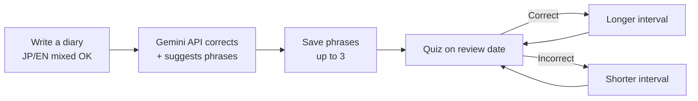
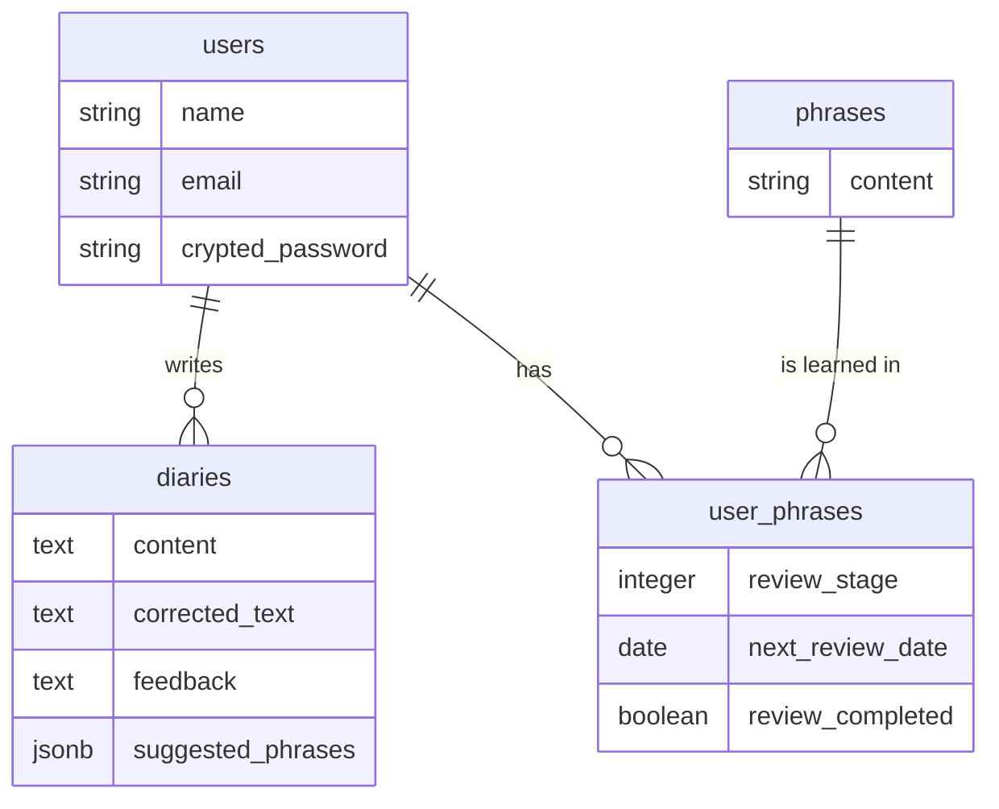

# English Diary

**Write a diary in English → get AI corrections → save useful phrases → review them on a spaced-repetition schedule** — all in one app.

English Diary is a writing-practice app for Japanese learners of English. Users can write freely, even mixing Japanese and English, and the AI rewrites the entry into natural English with feedback. The phrases they want to remember are then brought back for review right when they are about to forget them.

> 🇯🇵 The UI and AI feedback are in Japanese because the target users are Japanese learners. A Japanese version of this README is available in [README.ja.md](./README.ja.md).

## Demo

🔗 **Live app:** https://final-project-d423.onrender.com

> Hosted on Render's free plan, so the first load may take 30–60 seconds while the server wakes up.

### Test account

| Field | Value |
| --- | --- |
| Email | test@example.com |
| Password | test12345678 |

---

## Why I built it

To expand my own English expression, I used to write a diary, have Gemini correct it, copy useful phrases into a notebook, and review them later. This had two problems:

- I had to switch between Gemini, a notebook, and a calendar for every correction, note, and review.
- I had to manage review timing myself, which made the habit hard to keep.

In my previous job, moving from paper notes to OneNote made information searchable and greatly improved my efficiency. I applied the same idea here: **put the whole learning loop in one place and let the app manage review timing**, so busy learners can stay consistent.

**Target user:** intermediate learners who can already express their opinions in English but keep using the same expressions — typically working professionals who study for about an hour on weekday evenings.

## Features

| Feature | Description |
| --- | --- |
| AI diary correction | The Gemini API rewrites a mixed Japanese/English diary entry into natural English and returns feedback in Japanese |
| Phrase suggestions | The AI suggests three phrases worth learning; users pick which ones to save (up to 3 per entry) |
| Spaced-repetition review | Saved phrases are quizzed at increasing intervals; the next review date adjusts based on correct/incorrect answers |
| Practice writing | Users write a short passage using the day's review phrases, and the AI checks whether they are used naturally |
| Review calendar | A monthly calendar shows upcoming reviews and the days a diary was written |
| History | Browse all saved phrases and past diary entries |
| Account | Sign up, log in, and update email and password |

### Learning flow

## Tech stack

| Category | Technology |
| --- | --- |
| Backend | Ruby 3.3 / Ruby on Rails 7.1 |
| Frontend | Hotwire (Turbo / Stimulus) / Tailwind CSS |
| Database | PostgreSQL (Supabase) |
| Authentication | Sorcery |
| External API | Gemini API (via ruby-openai, using the OpenAI-compatible endpoint) |
| Testing & quality | RSpec / FactoryBot / SimpleCov / Bullet / RuboCop |
| CI/CD | GitHub Actions |
| Hosting | Render |

## Technical highlights

### 1. Spaced-repetition scheduling (SRS)

Each saved phrase has a review stage and a next review date. The interval grows with each stage:

| Stage | 0 | 1 | 2 | 3 | 4 |
| --- | --- | --- | --- | --- | --- |
| Days until next review | 1 | 3 | 7 | 14 | 30 |

- **Correct:** move up one stage (max: 4)
- **Incorrect:** move down one stage (min: 0)

A wrong answer drops the phrase by only one stage instead of resetting it to zero, because starting over after a single mistake tends to hurt motivation. The intervals live in one constant (`UserPhrase::REVIEW_STAGES`), so adding a stage is a one-line change.

### 2. Service objects for separation of concerns

Date calculations and API calls are extracted into service objects, keeping controllers thin and making the logic easy to unit-test.

| Class | Responsibility |
| --- | --- |
| `ReviewScheduleInitializer` | Sets the first review date when a phrase is saved |
| `ReviewResultService` | Calculates the next stage and review date from a review result |
| `PhraseSaveService` | Normalizes phrases (deduplication, 3-item limit) and saves them |
| `GeminiCorrectionService` | Sends the diary to the Gemini API and stores the result |
| `ReviewCalendarBuilder` | Groups scheduled reviews by date for the calendar view |

### 3. Treating AI output as structured data

The Gemini API is instructed to **respond in JSON** (corrected text, feedback, and three suggested phrases), so the app can store and render the result directly. Diary correction and practice-writing correction use different prompts. If the API call fails, the diary entry is still saved and the user sees an error message.

### 4. Data model

Phrases (`phrases`) are stored separately from each user's learning progress (`user_phrases`), so the same phrase saved by many users is not duplicated. A unique constraint on `user_id` + `phrase_id` prevents a user from saving the same phrase twice.

### 5. Testing and CI

- RSpec tests cover models, requests, and service objects.
- Every pull request runs **RuboCop → asset build → RSpec** on GitHub Actions.
- Bullet detects N+1 queries during development.

## Planned improvements

- **Rethink the review-completed flag:** completion can be derived from the next review date alone, so `review_completed` is redundant. I plan to store `last_reviewed_on` instead, which also enables a "today's progress" view.
- **Search for saved phrases**
- **Rebuild the frontend in React (Next.js)**
- **Reminder notifications** to support daily habits

## About this project

- **Development period:** July–October 2026 (final project at RUNTEQ, a Japanese programming bootcamp)
- **AI-assisted development:** I used AI coding tools (Cursor) throughout, making sure I read, understood, and could explain every piece of generated code before committing it.
- **Screen flow diagram:** [Figma](https://www.figma.com/design/4TZx4K0V8tFzPrwdDqJfku/RUNTEQ_Final-project?node-id=0-1&p=f&t=nPtlhmujsjpgtzMD-0)
